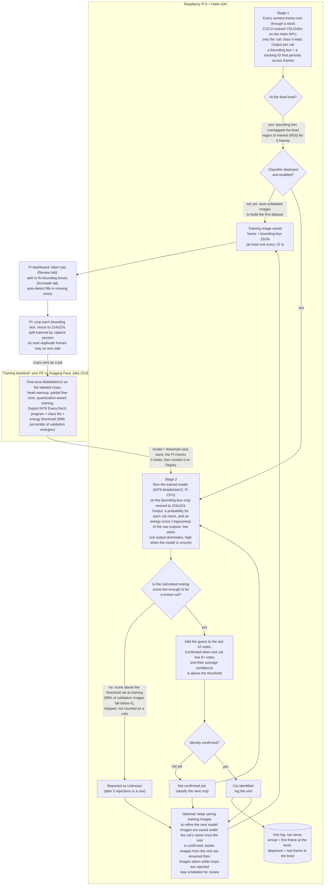
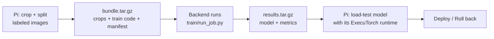

# Purrceptron

Purrceptron identifies individual cats at a food bowl using a Raspberry Pi 5 and a
Hailo-10H accelerator. The stock COCO detector on the NPU finds the cat, an INT8
MobileNetV2 on the CPU identifies which cat it is, and each visit is logged with its
start time, end time and duration. An IR camera keeps it working at night.

Everything is driven from one web dashboard on the Pi:

- `pi_dashboard.py` runs on the Pi. It collects training images from the camera,
  provides labeling and bounding-box tools, runs detection and identification
  continuously, and displays the visit log. It launches `deploy/detect.py` and the
  classifier worker.
- Training needs a GPU, so the dashboard sends training jobs to a backend: your own
  Linux or WSL2 PC running the headless `train_worker.py`, or Hugging Face Jobs (a
  pay-per-minute cloud GPU). The trained model comes back to the Pi, which checks it
  and installs it when you click Deploy.

`scripts/sync_to_pi.sh` pushes the code from your development machine to the Pi over
SSH.

Design points:

- No detector is trained. hailo-apps ships with a COCO-trained YOLOv8m that detects
  cats reliably, and its bounding box is saved alongside every capture. The only
  trained model is the classifier that tells the individual cats apart.
- Once a classifier is deployed, detection-triggered capture saves new images under
  the cat name the classifier confirmed, so each training round has more labeled
  data than the previous one with little manual effort.
- The classifier computes an energy score for every crop and rejects crops that do
  not resemble any cat it was trained on. A visiting cat is reported as "Unknown"
  rather than assigned the nearest known name.
- The classifier is trained with quantization-aware training and exported as an
  INT8 ExecuTorch program (XNNPACK backend), which classifies a crop in about 10 ms
  on one Pi CPU core.

The same approach applies to other animals in the COCO classes (dogs, birds,
horses): set `deployment.tracking_objects` to the detector label and list the
individuals under `cats:`. Animals outside those classes, such as rabbits, would
need a different detector, and the Annotate tab's auto-detect currently looks for
cats only.

> **License notice:** source-available for noncommercial use only. No redistribution,
> no commercial use, and no use as AI/ML training data. Models you train with this
> software are for your own noncommercial use only. See [License](#license).

## Contents

- [How it works](#how-it-works)
- [Hardware](#hardware)
- [Software requirements](#software-requirements)
- [Quick start](#quick-start)
- [Pi dashboard](#pi-dashboard)
- [Training from the Pi](#training-from-the-pi)
- [Backups](#backups)
- [How training works](#how-training-works)
- [Inference details](#inference-details)
- [Configuration reference](#configuration-reference)
- [Project structure](#project-structure)
- [Troubleshooting](#troubleshooting)
- [Known limitations](#known-limitations)
- [Contributing](#contributing)
- [License](#license)

## How it works

The system is a loop between the two machines. The Pi captures training images
while it runs; the training machine turns them into a classifier; the classifier
goes back to the Pi, where it identifies cats and files new captures under their
names, so the next round of training needs less manual labeling.



1. hailo-apps runs a GStreamer pipeline with YOLOv8m on the Hailo-10H, plus a
   tracker that gives each detection a persistent ID. Detections whose label is not
   in `deployment.tracking_objects` (default `["cat"]`) are discarded.
2. A detection is passed to the classifier only after it has overlapped the
   configured bowl region for `classifier.stability_frames` consecutive frames.
3. The crop is resized to 224x224 and classified by MobileNetV2 in a separate
   process on one CPU core, at most once per `classify_interval_seconds`.
4. The classifier can only choose among the cats it was trained on, so it always
   names one of them, even for a cat it has never seen. The softmax confidence does
   not help here: softmax rescales the outputs to sum to 1, so an unfamiliar cat
   whose raw scores are all weak can still come out as "90% Cat1". To catch that,
   each prediction is checked a second time with an energy score computed from the
   same raw outputs (logits), before softmax throws their magnitude away. The energy
   is `-log(sum(exp(logits)))`: one strong logit, which is what the trained cats
   produce, gives a low energy; uniformly weak logits, typical of an unfamiliar
   cat, give a high one (Liu et al., 2020, "Energy-based Out-of-distribution
   Detection"). It costs nothing at runtime because it reads the forward pass the
   classifier already ran. The threshold comes from training: the exported INT8
   model scores every validation image, and the cutoff is set so that 99% of them
   pass (`energy_ood_percentile`). It is stored in the model file. A crop whose
   energy is above the threshold is rejected and does not vote, so an unfamiliar cat
   is reported as Unknown instead of being given the nearest known name.
5. A rolling window of predictions confirms an identity once one cat holds a
   majority and the average confidence is above `confidence_threshold`.
6. Each confirmed visit is written to `classifier_log.db` with the cat, the time of
   the first and last frame it was seen at the bowl, the duration, average
   confidence and frame count. The Pi dashboard lists these by day with total
   tracked time per cat.
7. If detection capture is enabled, stable in-bowl detections are saved with their
   bounding box in a JSON sidecar, ready for the next training round. An image is
   named after the cat the current visit was confirmed as, the same cat the visit
   log records. Images taken earlier in the visit, while the vote was still
   undecided, are saved to `unlabeled/` and moved into the cat's folder once the
   visit is confirmed. Images taken while crops are being rejected by the energy
   check stay in `unlabeled/` for manual review, because the rejection may be a
   different cat.

## Hardware

**Raspberry Pi side (capture and inference)**

- Raspberry Pi 5
- [Raspberry Pi AI HAT+ 2](https://www.raspberrypi.com/documentation/accessories/ai-hat-plus.html)
  with the Hailo-10H accelerator (40 TOPS INT4)
- USB camera. Built and tested with the
  [Arducam B0205 1080P Day & Night Vision USB Camera](https://www.amazon.com/dp/B0829HZ3Q7)
  (2MP, IR LEDs, automatic IR-cut switching), which lets detection run in the dark.
  Other USB cameras should work.

**SD card wear.** The Pi writes continuously, and an SD card wears out from
writes (an endurance-rated card failed after about two years). The project keeps
writes low:

- The live preview frame, its detections and the classifier status, rewritten
  many times a second, live in RAM (`/dev/shm/cat_detection/`).
- The dashboard doesn't log its polling requests; `logs/pi_dashboard.out` is
  rotated at 10 MB, and detection logs older than `logging.keep_days` (90) are
  deleted. All other logs are kept.
- Training jobs reuse cached crops and build their bundle in RAM.
- `scripts/setup_pi.sh` turns off the swap file on the card (compressed RAM swap
  only), keeps the system journal across reboots but capped at 200 MB, and checks
  that `/tmp` is in RAM.

**Training side**

- A Linux or WSL2 machine. An NVIDIA GPU with CUDA is recommended but not
  required: without one, training and auto-detect run on the CPU, much more
  slowly. Quantization-aware training uses the GPU too; the final INT8 export runs
  on the CPU.

## Software requirements

**Pi**

- 64-bit Raspberry Pi OS with the AI HAT+ 2 drivers installed
  (`sudo apt install hailo-h10-all`) as described in the Raspberry Pi documentation.
  `scripts/setup_pi.sh` does not install the Hailo runtime; it expects it to be there.
- [hailo-apps](https://github.com/hailo-ai/hailo-apps). `setup_pi.sh` clones it into
  `hailo-apps/` inside the project, checks out the commit this project runs on
  (29acd11, with HailoRT 5.1.1), and runs its installer. To use a newer hailo-apps
  with a newer HailoRT, set `HAILO_APPS_COMMIT` when running `setup_pi.sh`.
- Everything runs in the single Python virtual environment that hailo-apps creates
  (`hailo-apps/venv_hailo_apps`), activated with `source hailo-apps/setup_env.sh`.
  `setup_pi.sh` installs `requirements-pi.txt` (Flask, OpenCV, NumPy, PyTorch, PyYAML)
  and the ExecuTorch runtime the classifier uses into it. ExecuTorch is installed
  without its declared dependencies, which are only needed for exporting models;
  after updating an existing Pi, run those two `pip install` lines from
  `setup_pi.sh` again in the activated venv.

**Training machine**

Only needed for the Local PC backend (Hugging Face Jobs needs no machine of your
own), and to push code to the Pi:

- Linux, or WSL2 on Windows (the tested setups), with `rsync` and `ssh`.
- For the worker, either:
  - Docker with the NVIDIA Container Toolkit (recommended). `compose.worker.yaml`
    builds an image from the same `pytorch/pytorch` base image Hugging Face jobs use
    and installs `requirements-training.txt` into it, so every package version is
    pinned in one place. The GPU driver must support CUDA 12.6.
  - Or Python 3.10 or newer (developed on 3.12): `scripts/setup_training.sh`
    creates `venv_train` and installs `requirements-training.txt` (PyTorch,
    torchvision, ExecuTorch and torchao, Albumentations, scikit-learn, OpenCV,
    Flask, PyYAML). The default PyTorch build there needs a driver that supports
    CUDA 12.8. Start the worker with `venv_train/bin/python train_worker.py`; it
    runs every job with that Python.

## Quick start

```bash
# ── On the training machine ─────────────────────────────────────────────
git clone https://github.com/zstrathe/Purrceptron.git
cd Purrceptron
bash scripts/setup_training.sh          # creates venv_train, reports your GPU

cp configs/project.yaml.example configs/project.yaml
# Edit configs/project.yaml: list the cat names under "cats:", set camera.device.

ssh-keygen -t ed25519                   # skip if you already have a key
ssh-copy-id <user>@<pi-hostname>

cat > .env << 'EOF'
PI_USER=<user>
PI_HOST=<pi-hostname>
PI_REMOTE_DIR=~/Repos/cat_detection
EOF

./scripts/sync_to_pi.sh                 # rsync the project (including project.yaml) to the Pi

# ── On the Pi ───────────────────────────────────────────────────────────
ssh <user>@<pi-hostname>
cd ~/Repos/cat_detection
bash scripts/setup_pi.sh                # one time: hailo-apps, Python deps, data dirs
source hailo-apps/setup_env.sh
python pi_dashboard.py                  # open http://<pi-ip>:5003

# In the browser: turn on "Auto-save" under Detection Capture, or use the
# Auto button to capture a chosen cat every few seconds. Aim for 300+ images
# per cat. Label anything in "unlabeled" on the Review tab, and give images
# without a bounding box one on the Annotate tab.

# ── Back on the training machine (for the Local PC backend) ─────────────
echo "WORKER_TOKEN=$(openssl rand -hex 24)" >> .env
scripts/worker.sh                       # GPU worker in Docker on port 5004; shows its output
# (without Docker: venv_train/bin/python train_worker.py)
# The Pi must reach this port; under WSL2 run scripts\windows_port_forward.ps1
# once as administrator (see "Training from the Pi").

# ── In the Pi dashboard ─────────────────────────────────────────────────
# Training tab: choose Local PC, enter the PC's address, the port (5004, or
# 5005 through the WSL port forward) and the token, press Test connection,
# then Save. Press Start training, wait for Ready, compare the accuracy, and
# press Deploy. Then turn on "Enable classifier" on the Capture tab: the
# identity bar shows who is at the bowl.
```

`sync_to_pi.sh` pushes `configs/project.yaml` too, so edit it on the training machine.
Settings changed in the Pi dashboard are stored separately in `configs/runtime.yaml`
on the Pi, which is never synced, so they survive the next push.

## Pi dashboard

`pi_dashboard.py` runs on the Pi and serves on port 5003. It starts `deploy/detect.py`
as a subprocess from inside `hailo-apps/` with `setup_env.sh` sourced, restarts it if
it crashes, and restarts it when a new classifier model is copied over (provided the
classifier was enabled when the dashboard started).

```bash
python pi_dashboard.py --no-camera        # review only, no detection pipeline
python pi_dashboard.py --host 0.0.0.0 --port 8080
python pi_dashboard.py --config alt.yaml
```

### Capture tab

The live feed is a JPEG preview that the browser polls about 15 times a second.
Bounding boxes are drawn with the detector label, confidence and tracker ID. Around it:

- Detection Mode: pipeline status, the tail of the detector log, and a viewer for
  the log files in `logs/detection/`.
- Detection Capture: an auto-save toggle, the minimum seconds between saves per
  cat, and "Save labeled only", which skips captures the classifier has not
  identified. Changes take effect immediately.
- Cat Classifier (Stage 2): an enable toggle (restarts the pipeline with the
  model), model status, confidence threshold, and the bowl region. Drag on the
  preview to set the region, show or hide it, and set the overlap percentage that
  counts as being at the bowl. Changes take effect immediately and are saved to
  `runtime.yaml`.
- The identity bar shows the current result with vote counts (for example
  `Cat1:6 Cat2:2 / 10`), "Unknown" for rejected crops, and "Waiting for detection in
  ROI..." between visits.
- Auto capture: a toggle and a target-cat dropdown. While on, a full frame is saved
  under that cat every `collection.auto_capture_interval_sec` seconds (default 3),
  with a bounding-box sidecar whenever the detector saw a cat in the frame.

### Review tab

A split view: the current image and its controls on the left, and a resizable,
full-height image browser on the right. There is one label button per cat, plus
Delete (moves the file to `data/trash/`), Prev and Skip. Skip marks the image as
reviewed. Unreviewed images are queued newest first; the browser shows every image,
with reviewed ones dimmed.

In the browser, click opens an image, Ctrl/Cmd-click or right-click selects, and
Shift-click selects a range. Selected images can be labeled or deleted together.
The browser sorts by newest or by label and filters with chips for All, Unlabeled
and each cat. Thumbnails are generated once and cached under `data/raw/.thumbnails/`.

Keyboard shortcuts: `1` to `9` label as that cat, `d` delete, `n` or `→` skip, `p` or
`←` previous, `Esc` closes the log viewer.

### Annotate tab

Lists every image in the cat folders and `unlabeled/`, grouped by folder, with each
saved bounding box drawn on its thumbnail and a "Missing" badge on those without
one. A status filter (All, Missing, Has one) and per-cat chips narrow the list; it
opens on Missing. Only images with a bounding box can be cropped for training, so
this is where images that arrived without one (phone photos, captures the detector
missed) get one: drag on the image to draw it, or press Auto-detect.

Auto-detect runs a COCO-pretrained torchvision Faster R-CNN (ResNet50 FPN v2), which
is too heavy for the Pi, on the training backend:

- With the Local PC backend, Auto-detect asks `train_worker.py` for the current
  image's bounding box and shows it within a second (the first request loads the
  model, about 20 seconds).
- "Auto-detect all missing" sends every image without a bounding box as one job, on
  either backend. On Hugging Face Jobs that takes a few minutes, mostly container
  start-up. The results are saved as auto-detected; an image you annotate while the
  job runs is left alone.

Bounding boxes are saved as soon as they are drawn, in the same sidecar format the
Pi's detection capture writes. Editing a Pi-generated bounding box keeps a backup,
and Clear restores it. Keyboard shortcuts: `a` auto-detect, `d` clear, `n`/`p` or
the arrow keys step through the filtered list.

### Training tab

Runs training from the Pi: picks where jobs run (your PC or Hugging Face Jobs),
checks there are enough labeled images, packages them, sends the job, shows its
progress and log, and deploys or rolls back the returned model. It also edits the
training settings, runs cross-validation, and charts each job's loss and accuracy
curves, optionally against an earlier job. See
[Training from the Pi](#training-from-the-pi).

### Backup tab

Sets up nightly backups of the Pi's data to the PC or Hugging Face, shows the last
result and the snapshots, and runs a backup on demand. See [Backups](#backups).

### Sidebar

Shown on the Capture tab: image counts per cat against
`collection.min_images_per_cat`, session counters, pipeline status, recent
detections, and, when the classifier is enabled, the day's identified visits from
`classifier_log.db` with total tracked time per cat. Arrow buttons step through
earlier days.

## Training from the Pi

The Pi dashboard's Training tab runs a whole training round: the Pi packages its
labeled images, sends them to a training backend, gets the model back, checks it,
and deploys it when you click Deploy.



1. **Package (on the Pi).** `train/crop_images.py` and
   `train/prepare_classifier_dataset.py` run on `data/raw/<cat>/` at low priority,
   kept off the classifier's CPU core. Only images with a bounding-box sidecar
   count. The 224x224 crops, a copy of `train/` and `utils/`, and a manifest (cats,
   `classifier_training` settings, the Pi's torch and ExecuTorch versions) are
   packed into one tarball, typically a few MB to a few tens of MB. Crops are kept
   in `data/crop_cache/` and reused by later jobs while the image, its bounding box
   and the padding are unchanged, so only new or edited images are cropped again.
   The tarball is built in RAM (`/dev/shm`) when it fits and deleted after upload.
2. **Train (on the backend).** Every backend runs the same `train/run_job.py`
   from the bundle, which runs the bundled `train_classifier.py`. The bundled copy
   writes only inside the job's folder, so a job never overwrites the PC's own
   `models/cat_classifier.pte`.
3. **Check (on the Pi).** The returned model must load with the Pi's ExecuTorch
   runtime, embed the configured cat names and an energy threshold, and produce
   one output per cat. A model that fails is never offered for deployment.
4. **Deploy.** The tab compares the new model's validation accuracy, overall and
   per cat, with the deployed one, then installs it on request. The current model
   is kept as `models/cat_classifier.prev.pte`; Roll back swaps the two (pressing it
   again swaps back). Detection restarts with the new model within seconds.
   Models are ExecuTorch `.pte` files; an older TorchScript `cat_classifier.pt` is
   not used, so after the switch there is nothing to roll back to until a second
   `.pte` has been deployed.

The same path runs two other kinds of job: **cross-validation** (the Training tab's
"Run cross-validation"; it sends the crops unsplit, trains one model per fold with
`train/cross_validate.py`, and shows the per-fold table) and **auto-detect** (the
Annotate tab's "Auto-detect all missing"; it sends the images that have no
bounding box and writes the results into their sidecars).

**Settings.** The Training Settings panel edits the `classifier_training` values
(epochs, learning rates, augmentation, class balance, unknown-cat percentile) and
`classifier.crop_padding`. They are saved to the Pi's `runtime.yaml` and travel to
the backend in each job.

**Curves.** Every training job brings back its `results.csv`. Pick a job under
Training Curves to see loss, accuracy and per-cat validation accuracy for all
phases or one phase, and "Compare with" an earlier job to overlay its validation
curves.

Job state is saved to `data/training_jobs/<job_id>/state.json`, so restarting the
Pi dashboard while a job runs resumes watching it. Logs go to
`logs/training_jobs/`. One job runs at a time.

### Backends

| Backend | Cost | Where your images go | Setup |
|---|---|---|---|
| Local PC | Free | Your network only | `WORKER_TOKEN` in the PC's `.env`; PC reachable from the Pi |
| Hugging Face Jobs | Billed per minute from prepaid credits; a full training is about $0.15 (12 min on the default L4) | A private HF bucket, deleted after the model is downloaded | HF account with credits; a write token |

Pick the backend, fill in its settings, and press **Test connection** on the
Training tab, then **Save**. Tokens are stored in `configs/secrets.yaml`
(gitignored, owner-only permissions) and are never sent back to the browser;
other settings go to `configs/runtime.yaml`.

**Local PC.** `train_worker.py` runs on the PC and does the jobs the Pi sends. It
has no web page of its own. It runs on Linux or in WSL2, either in Docker
(recommended: one image pins every package, built from the same base image
Hugging Face jobs use) or from `venv_train`.

1. Put a token in the PC's `.env` (a line `WORKER_TOKEN=<any long random string>`;
   `openssl rand -hex 24` makes one).
2. Start the worker. With Docker, `scripts/worker.sh` does the usual things:
   ```bash
   scripts/worker.sh            # start it if needed, then show its output live
                                # (Ctrl+C stops watching; the worker keeps running)
   scripts/worker.sh run        # run it in this terminal; Ctrl+C stops the worker
   scripts/worker.sh status     # container state, GPU and versions, recent jobs
   scripts/worker.sh stop       # stop it (a running job is cancelled)
   ```
   It wraps `docker compose -f compose.worker.yaml` (`up -d --build`, `logs -f`,
   `down`), which also work directly.
   The container restarts with Docker (`restart: unless-stopped`). The project
   folder is mounted read-only, so a code update needs only
   `docker compose -f compose.worker.yaml restart`; a changed
   `requirements-training.txt` needs `up -d --build`. Job folders and downloaded
   model weights live in Docker volumes. `WORKER_PORT=5006 docker compose ...`
   publishes another port.

   Without Docker:
   ```bash
   bash scripts/setup_training.sh
   venv_train/bin/python train_worker.py         # --port to change 5004
   ```
   Either way it prints the GPU and the torch and ExecuTorch versions it found, and
   refuses to start without a token or without ExecuTorch. Stopping it (Ctrl+C, or
   `docker compose ... down`) also stops any job it is running.
3. Make the worker reachable from the Pi.
   - Linux PC: allow port 5004 in its firewall, if it has one. The Pi uses port 5004.
   - WSL2 on Windows 10, or with WSL's default networking: run once, in an
     administrator PowerShell:
     ```powershell
     powershell -ExecutionPolicy Bypass -File scripts\windows_port_forward.ps1
     ```
     It forwards LAN port 5005 to the worker in WSL and opens 5005 in the firewall
     for Private networks. Nothing needs updating after reboots. The Pi uses port
     5005. `-Remove` undoes it.
   - WSL2 on Windows 11 22H2 or later can use mirrored networking instead: put
     `networkingMode=mirrored` under `[wsl2]` in `%UserProfile%\.wslconfig`, run
     `wsl --shutdown`, and allow the port in an administrator PowerShell. The Pi
     then uses port 5004.
     ```powershell
     New-NetFirewallHyperVRule -Name WSLTrainingWorker -DisplayName "WSL training worker" -Direction Inbound -VMCreatorId '{40E0AC32-46A5-438A-A0B2-2B479E8F2E90}' -Protocol TCP -LocalPorts 5004
     ```
4. On the Pi's Training tab, enter the PC's LAN address, the port from step 3, and
   the token. Test connection reports the PC's GPU and torch and ExecuTorch
   versions, and warns when the ExecuTorch version differs from the Pi's.
   Reserving the PC's address in your router keeps this setting valid.

Job files stay on the PC: the extracted bundle, everything the job wrote, and
`worker.log`. They go in `data/worker_jobs/<job_id>/`, or in
`~/.local/share/cat_detection/worker_jobs/` when the project is on a Windows drive
under WSL (`/mnt/c/...`), where thousands of small files unpack and load slowly.
`--jobs-dir` picks another folder (in Docker they are in the `worker-jobs` volume).
At startup the worker keeps the 10 newest job
folders and deletes older ones (`--keep-jobs`, 0 keeps all). Each job's output is
also shown in the worker's terminal as it runs.

**Hugging Face Jobs.**

1. Create an account at huggingface.co, add prepaid credits under Settings >
   Billing, and create an access token with write permission.
2. On the Training tab choose Hugging Face Jobs and paste the token. Leave
   Namespace blank to bill your own account, or enter an organization.
3. Hardware: the default `l4x1` ($0.80/h, 8 CPUs) trained a full model in 12 min
   for $0.16 (measured 2026-11-15). What limits speed is mostly the CPUs, which
   prepare the training images: `t4-small` ($0.40/h, 4 CPUs) took 22 min for about
   the same cost, `t4-medium` 15 min, `a10g-large` 10 min for $0.25, and
   `a10g-small` (4 CPUs) 19 min for $0.31. Docker image blank picks the
   `pytorch/pytorch` CUDA runtime image with the Pi's torch version, and the job
   installs the Pi's ExecuTorch version into it, so the model loads on the Pi; set
   the image explicitly if Test connection reports that no matching image exists.

The job uploads the bundle to a private bucket (`<namespace>/cat-training` by
default), mounts the job's folder in the container, installs the few extra
packages training needs, and writes the results back to the bucket. The Pi
downloads them and deletes the job's files from the bucket. The tab links to the
job's page on huggingface.co while it runs. If the bucket exists but is public,
the job stops before uploading anything.

### Adding a backend

A backend is one module in `remote_training/backends/` that subclasses
`TrainingBackend` (`base.py`): declare its settings with `config_schema()` (the
Training tab builds its form from this), and implement `test_connection`,
`submit` (upload the bundle and start `code/train/run_job.py`), `poll`, `cancel`,
`fetch` (download the `results.tar.gz` that `run_job.py` wrote) and optionally
`cleanup`. Register it in `BACKENDS` in `remote_training/backends/__init__.py`.

### Moving over from the PC training dashboard

Earlier versions had a second dashboard on the PC that labeled and annotated images
inside `versions/<v>/raw_images/`. That work never went back to the Pi. To copy it
over once, run on the PC:

```bash
python scripts/push_labels_to_pi.py --version versions/<v>           # dry run: shows what would change
python scripts/push_labels_to_pi.py --version versions/<v> --apply
```

It moves images the PC labeled out of the Pi's `unlabeled/`, sends bounding boxes
drawn or edited on the PC, and reports images the Pi holds under a different cat
(skipped unless `--prefer-pc`). Images you deleted on the Pi stay deleted; images the
Pi never had are copied only with `--include-missing`. Running it again sends
nothing new.

### Command line

The training scripts also run directly on the PC, without the Pi dashboard:

```bash
source venv_train/bin/activate
V=versions/v1
bash scripts/pull_dataset.sh                       # rsync the Pi's data/raw/
python train/import_captures.py --output-dir $V/raw_images
python train/crop_images.py --input-dir $V/raw_images --output-dir $V/cropped_images --padding 0.2
python train/prepare_classifier_dataset.py --source-dir $V/cropped_images --output-dir $V/classifier_dataset
python train/cross_validate.py --source-dir $V/cropped_images --output-dir $V/cv_results   # optional
python train/train_classifier.py --dataset-dir $V/classifier_dataset --output-dir $V
bash scripts/transfer_model.sh $V/cat_classifier.pte # scp the model to the Pi
```

`train_classifier.py --skip-phase N` skips a phase (1 to 3). Skipping phase 3 also
skips the INT8 export.

## Backups

The Pi dashboard's Backup tab backs up the Pi's data every night, to the PC worker
(Local PC) or a private Hugging Face Storage Bucket.

**What is backed up:** captures and their bounding box sidecars (`data/raw/`,
including `unlabeled/`), `data/trash/`, the classifier and feeding databases,
`models/` (deployed, previous and candidate models), `configs/project.yaml` and
`runtime.yaml`, `logs/`, and training job records. `configs/secrets.yaml` and `.env`
are included only for the Local PC, never for the cloud. Thumbnails and the crop
cache are skipped; they are rebuilt automatically.

**How it works:** each run saves a snapshot, a complete copy of those files as they
were at that moment. Deleted files are absent from later snapshots but stay in older
ones until those expire. File contents are stored once by their SHA-256, so files
that didn't change cost nothing in later snapshots. Snapshots older than the
retention period (default 30 days) are deleted, the newest is always kept, and
stored files that no remaining snapshot uses are removed. Databases are copied with
SQLite's backup API, so the copy is consistent even while the classifier writes.
Runs happen in a low-priority process off the classifier's CPU core.

**Schedule:** every night at the set time (default 03:00). If the Pi or the
destination was off then, the backup runs as soon as it can and retries hourly
until it succeeds. "Back up now" runs one immediately.

**Destinations:**

- **Local PC:** the worker keeps the backups in `data/backups/` in the project on
  the PC (set `BACKUP_DIR` in `.env` to use another folder; the Docker worker mounts
  it). Leave the address and token blank to use the Training tab's Local PC
  settings. `scripts/worker.sh status` shows the number and size of snapshots.
- **Hugging Face:** a private bucket, `<namespace>/cat-backups` by default. Private
  storage counts toward your account's quota (100 GB on a free account; the Pi's
  data is about 1 GB). Leave the token blank to use the Training tab's Hugging Face
  token. A bucket that exists but is public is refused; nothing is uploaded to it.

**Restoring** never touches the live project: `scripts/restore_backup.py` restores
a snapshot into a new or empty folder, checks every file's SHA-256, and keeps the
original modification times. Copy what you need back to the Pi from there.

```bash
# Local PC backups
python scripts/restore_backup.py --source pc --dir data/backups --list
python scripts/restore_backup.py --source pc --dir data/backups --dest ~/restored
# Hugging Face backups (--snapshot ID for an older one; default latest)
HF_TOKEN=hf_... python scripts/restore_backup.py --source hf --bucket you/cat-backups --dest ~/restored
```

**Rebuilding the Pi** (a new SD card): flash 64-bit Raspberry Pi OS with Raspberry
Pi Imager, using the old hostname and user name, SSH with public-key login (paste
the training machine's public key) and Wi-Fi. Then, on the training machine:

```bash
./scripts/restore_pi.sh --from ~/restored     # or a manual copy with repo/, home/, snapshots/
```

It checks the Pi, updates the OS and installs the Hailo runtime, copies the code
from this machine and the data, models, logs and Pi-only settings from the backup,
runs `setup_pi.sh`, reboots when needed, and finally compares every restored file
with the backup. It never deletes data on the Pi and refuses to mix a backup into
a Pi that already has new images. `--steps` runs only some steps (see
`--help`). Tokens aren't in cloud backups; enter them again on the dashboard.

## How training works

The classifier is torchvision's MobileNetV2 with ImageNet weights. The
backbone is kept and a new linear head, sized to the number of cats, is trained on
top. Training requires at least two cats and runs in four phases.

1. Head warmup (FP32, default 20 epochs). Only the new head trains; the backbone is
   frozen. Learning rate 1e-3 with a linear warmup over `warmup_epochs` (default 5)
   followed by cosine decay.
2. Partial fine-tune (FP32, default 40 epochs). The last three feature stages of the
   backbone (`features[16:]`, two inverted-residual blocks and the final 1x1
   convolution) are unfrozen at 1e-5 while the head continues at 1e-4. Batch-norm
   statistics stay frozen. Mixup (`mixup_alpha`, default 0.2) is applied in this
   phase only. Stochastic weight averaging runs over the final 25% of the phase, and
   the averaged model replaces the checkpoint if its validation accuracy is at least
   as good. If accuracy is low, this is the phase to lengthen.
3. Quantization-aware training (default 10 epochs, on the GPU when there is one).
   The model is captured with `torch.export` and prepared by ExecuTorch's XNNPACK
   quantizer (torchao's PT2E flow): it trains with simulated INT8 quantization
   (per-channel weights) at a fixed 1e-6 learning rate and without augmentation,
   so it adapts to 8-bit rounding. For the last 20% of the phase the quantization
   ranges and the batch-norm statistics are frozen.
4. INT8 export. The best QAT epoch is converted to INT8 and lowered to an
   ExecuTorch program (`.pte`) that runs on XNNPACK, the CPU backend the Pi uses.

Data loading keeps the GPU busy and adapts to the machine it runs on; the job log
says what it chose. The crops are decoded once into memory instead of every epoch
(when they fit in half the available RAM). Loader workers apply the augmentation,
each with its own random stream: up to 8, two fewer than the usable CPUs
(container CPU limits count), and fewer still when `/dev/shm` is too small for
the batches they prepare. The unaugmented sets (validation, and QAT training) are
kept on the GPU when they fit in 40% of its free memory, otherwise in CPU memory
and copied one batch at a time, and are normalized on the GPU with the same values
Albumentations produces.

All phases use AdamW with `weight_decay` 0.005, batch size 32, label smoothing 0.1,
gradient clipping at norm 1.0, and early stopping after `patience` (default 15)
epochs without an improvement in validation accuracy. The best checkpoint of each
phase is selected by validation accuracy.

Cats with fewer images are balanced in one of three ways (`balance_method`):

- `oversample` (default): each epoch uses every real image once, then repeats the
  smaller classes' images until every cat has as many samples as the largest.
  Because augmentation is random, each repeat is a new variant of the photo, so a
  small class effectively gets extra synthetic examples every epoch. Nothing is
  written to disk and validation uses real photos only. Epochs get longer (number
  of cats times the largest class).
- `loss_weights`: each image of a smaller class counts more in the loss, in
  proportion to how much smaller the class is.
- `off`: no balancing.

Augmentation uses Albumentations, applied fresh each time an image is used: a
random resized crop (scale 0.8 to 1.0) is always applied, and horizontal flip,
brightness/contrast, shift-scale-rotate, Gaussian blur, coarse dropout and Gaussian
noise are on by default. Hue/saturation and CLAHE are available and enabled in the
shipped template. Validation applies normalization only.

After export, the ExecuTorch program itself (run with the ExecuTorch runtime, as on
the Pi) scores every validation image, and the `energy_ood_percentile` quantile
(default 0.99) of those energy values becomes the rejection threshold. It is
embedded in the program with the class list, as constant methods, so the Pi needs
no extra configuration for unknown-cat rejection.

Outputs go to the `--output-dir`: `cat_classifier.pte`, `training/results.csv` with
per-epoch loss, accuracy and per-class validation accuracy, `final_metrics.json`, and
the best checkpoint of each phase. Run from the command line, it also overwrites the
local `models/cat_classifier.pte`; a job from the Pi writes only inside the job's
folder. The script ends by evaluating the exported program on the validation set
with the ExecuTorch runtime and printing overall and per-class accuracy.

## Inference details

`deploy/detect.py` wraps hailo-apps' `GStreamerDetectionApp`. The dashboard starts it
with `cd hailo-apps && source setup_env.sh && python deploy/detect.py --enable-preview
--enable-stdin-commands`. To run it manually, use the same two environment steps.
Any extra arguments (for example `--input /dev/video2`) are passed through to
hailo-apps. Settings come from `configs/project.yaml` with `configs/runtime.yaml`
merged on top.

Gate: overlap is the intersection area divided by the bowl region's area, compared
with `classifier.roi_overlap_threshold` (default 1%). A detection that leaves the
region keeps its stability count for `classifier.miss_tolerance` frames (default 15);
after that the count resets and a departure signal closes the current visit.

Classifier worker: started before GStreamer initializes and pinned to
`classifier.cpu_core`. It loads the ExecuTorch program (XNNPACK backend, one
thread; about 10 ms per crop on a Pi 5 core), reads the class list and energy
threshold embedded in it (a
`classifier.energy_ood_threshold` setting overrides the embedded value), and applies
ImageNet normalization. Crops arrive on a bounded queue and are dropped when the
CPU falls behind. Each crop gets one forward pass; the energy score and the softmax
probabilities are both read from its logits, and the energy check runs first so a
rejected crop never reaches the vote window. The worker's state is written to `/dev/shm/cat_detection/classifier_status.json` (in RAM),
which the dashboard polls twice a second.

Vote window: a prediction is confirmed when one class holds more than half of
`vote_window_size` votes (6 of 10 by default) and the average confidence of those
votes is at least `confidence_threshold`. Rejected crops do not vote. "Unknown" is
reported after half a window of consecutive rejections.

Event log: `classifier_log.db`, table `classifier_events`, with `cat_name`,
`start_time`, `end_time` (UTC), `duration_seconds`, `confidence_avg` and
`frame_count`. The detector timestamps the first and last frame of each visit at
the bowl, so `start_time` is when the cat arrived, not when the vote confirmed it
(at least several seconds later). The row is written once the identity is
confirmed and closed when the cat leaves; on shutdown the end time is the shutdown
time.

Detection-triggered capture: when enabled, a detection is saved once it is stable
inside the bowl region, at most once per `min_interval_seconds`. Labels listed in
`unlabeled_classes` (`cat` for the stock model) are named by the classifier and
share one throttle, so a cat at the bowl is captured once per interval whatever
name its images are saved under; other labels are throttled separately.

Their name comes from the classifier's status file. Besides what the dashboard
shows, it records which visit the latest crop belongs to, whether that crop was
rejected, and the recent visits the classifier confirmed together with the cat
each was confirmed as (the visit's first confirmation, as in the event log). Visits
are the ones the classifier gate defines for the event log: from the first frame at
the bowl to the last.

- The current visit is confirmed: saved under that cat's name.
- The latest crop was rejected by the energy check, or the vote majority has moved
  to a different cat than the one the visit was confirmed as: saved under
  `unlabeled/` and left there for review. Rejection applies from the first
  rejected crop, before the dashboard shows Unknown.
- No decision yet for this visit: saved under `unlabeled/` and registered with the
  visit. When the visit is confirmed, these images and their sidecars are moved to
  the cat's folder and renamed `<cat>_<UTC timestamp>.jpg`, with a new line in
  `capture_log.csv`. A visit confirmed on its last crop, after the cat has gone,
  still counts. With `save_labeled_only`, they are deleted instead if the visit is
  not confirmed within 30 s of its last frame at the bowl, or when capture is
  switched off or detect.py stops.

While detection capture is off, nothing is saved, renamed or deleted.

If the classifier misses a departure (its queue was full), the first crop of the
next visit closes the previous one, so votes and names never carry over.

Each image gets a `.json` sidecar with the timestamp, image size and the in-region
detections (`label`, `confidence`, and `bbox_norm` as `[xmin, ymin, w, h]` in the
range 0 to 1), plus a line in `data/raw/capture_log.csv`. Files are named
`<label>_<UTC timestamp>.jpg`.

Feeding tracker (`feeding.*`): an earlier session tracker driven only by detector
labels. It logs a session only when the detector itself outputs one of the configured
cat names, which requires a custom HEF trained on them. With the stock COCO model,
per-cat visit logging comes from the classifier event log described above, which is
what the dashboard displays.

## Configuration reference

All settings live in `configs/project.yaml` (gitignored; copy
`configs/project.yaml.example`). The Pi dashboard writes the settings it changes to
`configs/runtime.yaml`, which overrides `project.yaml` on the Pi and is not synced.
The table lists the template's value; where the code uses a different fallback when
a key is omitted, it is noted.

| Key | Template value | Description |
|-----|----------------|-------------|
| `cats` | `[Cat1, Cat2, Cat3]` | Names of the individual cats to recognize. Required. Used as folder names, labels and dashboard buttons. Training needs at least two. |
| **Camera** | | |
| `camera.device` | `/dev/video0` | Passed to hailo-apps as `--input`. |
| `camera.width` / `height` | 1920 / 1080 | The camera's frame size. Used to convert normalized bounding boxes to pixels for the bowl-region test, so it must match the real frame size. |
| **Collection** | | |
| `collection.output_dir` | `data/raw` | Root of captured images on the Pi, used for review and counts. Required. |
| `collection.min_images_per_cat` | 300 | Per-cat target shown by the dashboard's progress bars. |
| `collection.auto_capture_interval_sec` | 3 | Seconds between frames in auto-capture mode. |
| **Web UI** | | |
| `web_ui.host` / `port` | `0.0.0.0` / 5003 | Pi dashboard bind address and port. Required. |
| `web_ui.preview_width` / `height` | 960 / 540 | Preview frame size. |
| **Deployment** | | |
| `deployment.hailo_apps_dir` | `./hailo-apps` | hailo-apps checkout, relative to the project root. |
| `deployment.hef_path` | `""` | Custom HEF model. Empty uses hailo-apps' default detector for the board. |
| `deployment.labels_json` | `""` | Label file for a custom HEF (hailo-apps format; see `deploy/coco_labels.json`). |
| `deployment.track_all` | true | Track every class, not only class 0. |
| `deployment.tracking_objects` | not in template; code default `[cat]` | Detector labels to keep. Everything else is dropped before the gate. |
| `deployment.preview_fps` | 15 (code fallback 10) | Preview write rate. Frames go to `/dev/shm/cat_detection/` (RAM), not the SD card. |
| `deployment.preview_jpeg_quality` | not in template; code default 70 | Preview JPEG quality. |
| **Classifier (Stage 2)** | | |
| `classifier.enabled` | false | Run the identity classifier. |
| `classifier.model_path` | `models/cat_classifier.pte` | ExecuTorch model the classifier runs. |
| `classifier.bowl_roi` | `[760, 390, 1160, 790]` (code fallback: full frame) | Bowl region `[x_min, y_min, x_max, y_max]` in frame pixels. Set it by dragging in the dashboard. |
| `classifier.roi_overlap_threshold` | 0.01 | Fraction of the bowl region a bounding box must cover to count. |
| `classifier.stability_frames` | 5 | Consecutive in-region frames before classifying (also gates detection capture). |
| `classifier.miss_tolerance` | not in template; code default 15 | Missed frames tolerated before a cat counts as departed. |
| `classifier.classify_interval_seconds` | 1.0 | Minimum time between crops sent to the classifier. |
| `classifier.crop_padding` | 0.0 (code fallback 0.2) | Padding around the bounding box as a fraction of its size, for live crops and the Crop step. |
| `classifier.vote_window_size` | 10 | Votes in the rolling window. |
| `classifier.confidence_threshold` | 0.5 (code fallback 0.85) | Minimum average confidence to confirm. |
| `classifier.energy_ood_enabled` | not in template; code default true | Reject crops above the energy threshold. |
| `classifier.energy_ood_threshold` | not in template; default from the model | Override the embedded threshold. |
| `classifier.db_path` | `data/classifier_log.db` | Identified-visit log. |
| `classifier.cpu_core` | 3 | Core the classifier process is pinned to. |
| **Detection capture** | | |
| `detection_capture.enabled` | false | Save stable in-region detections automatically. |
| `detection_capture.output_dir` | `data/raw` | Where captures go (also used for manual captures). |
| `detection_capture.unlabeled_classes` | `[cat]` (code fallback `[]`) | Detector labels saved as `unlabeled/`, or under the classifier's confirmed name. |
| `detection_capture.save_labeled_only` | false | Keep only named captures. Images waiting for the visit to be confirmed are kept until it is and deleted if it never is. |
| `detection_capture.min_interval_seconds` | 15 | Minimum seconds between saves. `unlabeled_classes` labels share one interval; other labels each have their own. |
| `detection_capture.max_captures_per_session` | 0 | Cap per saved label per run; 0 is unlimited. |
| `detection_capture.jpeg_quality` | 95 | JPEG quality. |
| `detection_capture.csv_logging` | true | Append to `capture_log.csv`. |
| **Feeding tracker** (see the note above) | | |
| `feeding.enabled` | false | Detector-label session tracking. |
| `feeding.db_path` | `data/feeding_log.db` | Session database. |
| `feeding.cooldown_seconds` | 30 | Seconds without detection before a session ends. |
| `feeding.min_detection_frames` | 3 | Frames before a session starts. |
| `feeding.log_interval_seconds` | 60 | Console status interval. |
| **Review** | | |
| `label_review.trash_dir` | `data/trash` | Where deleted captures are moved. |
| **Classifier training** | | |
| `classifier_training.phase1_epochs` | 20 | Head warmup epochs. |
| `classifier_training.phase2_epochs` | 40 | Fine-tune epochs. |
| `classifier_training.phase3_epochs` | 20 (code fallback 10) | QAT epochs. |
| `classifier_training.phase1_lr` | 0.001 | Phase 1 learning rate. |
| `classifier_training.phase2_backbone_lr` | 1e-5 | Phase 2 backbone learning rate. |
| `classifier_training.phase2_head_lr` | 1e-4 | Phase 2 head learning rate. |
| `classifier_training.warmup_epochs` | 5 | Linear warmup epochs in phase 1. |
| `classifier_training.weight_decay` | 0.005 | AdamW weight decay. |
| `classifier_training.batch_size` | 32 | Batch size. |
| `classifier_training.label_smoothing` | 0.1 | Cross-entropy label smoothing. |
| `classifier_training.gradient_clip_norm` | 1.0 | Gradient-norm clipping. |
| `classifier_training.mixup_alpha` | 0.2 | Mixup strength (phase 2). |
| `classifier_training.balance_method` | `oversample` | `oversample`, `loss_weights` or `off` (see How training works). Older configs without it use `balance_classes`: `false` means `off`, anything else `oversample`. |
| `classifier_training.patience` | 15 | Early-stopping patience, per phase. |
| `classifier_training.session_gap_minutes` | 5 | Gap that starts a new session for the train/val split and CV folds. |
| `classifier_training.cv_folds` | 5 | Default folds for the Training tab's cross-validation. |
| `classifier_training.energy_ood_percentile` | not in template; code default 0.99 | Validation-energy quantile used as the unknown-cat threshold. |
| `classifier_training.augmentation.*` | see template | Switches and limits for each augmentation: `horizontal_flip`, `brightness_contrast`, `brightness_limit`, `contrast_limit`, `shift_scale_rotate`, `rotate_limit`, `gaussian_blur`, `gaussian_noise`, `coarse_dropout`, `hue_saturation`, `clahe`. |
| **Training from the Pi** | | Set from the Pi dashboard's Training tab, which writes `runtime.yaml` (the `classifier_training` values above too). Tokens are kept in `configs/secrets.yaml`. |
| `training_backend.backend` | `local_pc` | Where jobs run: `local_pc` or `hf_jobs`. |
| `training_backend.min_images_per_cat` | 30 | Labeled images with bounding boxes each cat needs before a job can start. |
| `training_backend.local_pc.host` / `port` | `''` / 5004 | Address of the PC running `train_worker.py`. |
| `training_backend.hf_jobs.namespace` | `''` | HF user or organization that runs and pays for jobs; blank uses the token's user. |
| `training_backend.hf_jobs.flavor` | `l4x1` | HF Jobs hardware. |
| `training_backend.hf_jobs.timeout` | `2h` | Job time limit. |
| `training_backend.hf_jobs.image` | `''` | Docker image; blank picks `pytorch/pytorch` with the Pi's torch version. Jobs install the Pi's ExecuTorch version into it. |
| `training_backend.hf_jobs.bucket` | `''` | Private bucket for moving files; blank uses `<namespace>/cat-training`. |
| **Backups** | | Set from the Pi dashboard's Backup tab, which writes `runtime.yaml`. Tokens are kept in `configs/secrets.yaml`. |
| `backup.destination` | `off` | `off`, `local_pc` or `hf`. |
| `backup.time` | `03:00` | Local time of the nightly backup. |
| `backup.keep_days` | 30 | Snapshots older than this are deleted (the newest is always kept). |
| `backup.local_pc.host` / `port` | `''` | The PC worker; blank uses `training_backend.local_pc`. |
| `backup.hf.namespace` / `bucket` | `''` | Blank uses the token's user and `<namespace>/cat-backups`. |
| **Logging** | | |
| `logging.keep_days` | 90 | Detection logs (`logs/detection/`) older than this are deleted when the pipeline starts. 0 keeps them all. |

Keys in the template that nothing reads: `camera.fps`, `camera.format`,
`collection.images_per_session`, `collection.capture_interval_ms`,
`collection.jpeg_quality`, `deployment.detection_threshold`, `deployment.hw_arch`,
`deployment.filter_classes`, `detection_capture.filter_labels`, `label_review.host`,
`label_review.port` and `classifier_training.optimizer` (AdamW is always used).

## Project structure

```
Purrceptron/
├── pi_dashboard.py                 # Pi web dashboard: capture, review, annotate, training (port 5003)
├── train_worker.py                 # Headless worker on the PC for the Local PC backend (port 5004)
├── compose.worker.yaml             # Runs train_worker.py in Docker with the GPU
├── docker/worker.Dockerfile        # Worker image: pytorch/pytorch base + requirements-training.txt
├── templates/
│   └── dashboard.html              # Pi dashboard UI
├── static/
│   ├── css/theme.css               # Dashboard theme (colors, layout, image browser)
│   └── js/chart.umd.min.js         # Chart.js, served locally for the training charts
├── configs/
│   └── project.yaml.example        # Configuration template (copy to project.yaml)
├── docs/                           # future_work.md (look-alike cats, Hailo, CLIP); frigate.md
├── deploy/                         # Runs on the Pi
│   ├── detect.py                   # hailo-apps GStreamer pipeline, gate, capture, stdin commands
│   ├── cat_classifier.py           # Classifier worker process: INT8 MobileNetV2, energy check, voting, event log
│   ├── detection_capturer.py       # Frame extraction and asynchronous capture with sidecars
│   ├── feeding_tracker.py          # Detector-label session tracker
│   └── coco_labels.json            # COCO label list in hailo-apps format, for custom HEFs
├── collect/                        # Pi dashboard helpers
│   ├── label_review.py             # Review queue, thumbnails, relabel and delete
│   ├── export.py                   # Standalone dataset archive export (CLI)
│   └── capture.py                  # Legacy standalone capture app, not used by the dashboard
├── remote_training/                # Training jobs sent from the Pi (Training tab)
│   ├── manager.py                  # Job lifecycle on the Pi: package, submit, poll, fetch, finish, deploy
│   ├── bundle.py                   # Pack a job: crops (train, cross-validation) or images (auto-detect)
│   ├── settings.py                 # Training settings the Training tab edits
│   ├── metrics.py                  # results.csv to chart data
│   ├── validate_model.py           # Load-test a returned model with the Pi's ExecuTorch runtime
│   ├── worker.py                   # Job and backup API served by train_worker.py
│   ├── backends/                   # base.py interface, local_pc.py, hf_jobs.py
│   └── backup/                     # Nightly snapshots: format, store, core, destinations, manager
├── train/                          # Runs on the training machine
│   ├── run_job.py                  # Entry point every backend runs from a job bundle
│   ├── auto_detect.py              # Cat bounding boxes for images without one (Faster R-CNN)
│   ├── import_captures.py          # Copy data/raw/ into a version (command-line path)
│   ├── crop_images.py              # Crop detections using bbox sidecars
│   ├── prepare_classifier_dataset.py  # Session-aware train/val split
│   ├── train_classifier.py         # Four-phase MobileNetV2 training and ExecuTorch INT8 export
│   └── cross_validate.py           # Session-aware stratified k-fold
├── scripts/
│   ├── setup_pi.sh                 # Pi setup: hailo-apps, Python deps, SD card write settings
│   ├── restore_backup.py           # Restore a backup snapshot into a new folder
│   ├── restore_pi.sh               # Rebuild a Pi on a new card from a backup (runs on the PC)
│   ├── setup_training.sh           # Training venv and GPU check (Linux / WSL2)
│   ├── windows_port_forward.ps1    # One-time: let the Pi reach a worker inside WSL
│   ├── worker.sh                   # Start, watch and stop the Docker worker
│   ├── sync_to_pi.sh               # rsync the project to the Pi (.syncignore applies)
│   ├── pull_dataset.sh             # rsync data/raw/ from the Pi (command-line path)
│   ├── transfer_model.sh           # scp a model to the Pi (command-line path)
│   ├── push_labels_to_pi.py        # One-time: copy labels from an old PC version to the Pi
│   └── _common.sh                  # Shared helpers (.env loading)
├── utils/
│   ├── config.py                   # Config loading, runtime.yaml merge, path resolution, cat colors
│   ├── secrets.py                  # configs/secrets.yaml store for backend tokens
│   ├── sidecars.py                 # Bounding-box sidecar read/write, edit backup and restore
│   ├── display.py                  # Colored console output
│   ├── runtime_paths.py            # Often-rewritten files kept in RAM (/dev/shm)
│   └── thumbnails.py               # Cached thumbnails for the dashboard's image browsers
├── requirements-pi.txt
├── requirements-training.txt
└── requirements-scripts.txt
```

Runtime directories (gitignored): `data/` (captures, trash and job state on the Pi;
`data/worker_jobs/` on the PC), `versions/` (command-line training rounds), `models/`
(deployed model and validated candidates), `logs/`, `hailo-apps/`, `venv_train/`.

## Troubleshooting

"Hailo libraries not available": the detector has to run from the hailo-apps
environment (`cd hailo-apps && source setup_env.sh`). The dashboard does this
itself, so the error usually means `setup_pi.sh` has not been run or
`deployment.hailo_apps_dir` points to the wrong place.

Camera not found: run `ls /dev/video*` and set `camera.device` in
`configs/project.yaml`, or pass `--input /dev/videoN` to `detect.py`. `lsusb` should
list the camera.

Preview is slow: the preview rate is limited by `deployment.preview_fps` and by the
load on the Pi. It is independent of the detector's frame rate. Reducing
`web_ui.preview_width` and `height` helps.

Classifier shows "No model found" or never activates: the model must be at
`models/cat_classifier.pte` on the Pi (the Deploy step copies it there), and
"Enable classifier" must be on, which restarts the pipeline. The classifier only
runs for detections inside the bowl region, so check the region with "Show ROI" and
lower `roi_overlap_threshold` if detections rarely qualify.

Identity flips, or takes too long to confirm: raise `vote_window_size` for steadier
results, or lower `confidence_threshold` to confirm sooner. Confirmation needs a
majority of the whole window, so 10 votes at one crop per second takes about
5 seconds (6 agreeing votes, 5 intervals apart).

Classifier error "is not an ExecuTorch model": `classifier.model_path` still points
to an older TorchScript `.pt` file. Set it to `models/cat_classifier.pte` in
`configs/project.yaml` and deploy a model from the Training tab.

Everything shows as Unknown: the energy threshold was calibrated on your validation
images, and lighting very different from the training data raises energy scores.
Add images from those conditions and retrain, raise
`classifier.energy_ood_threshold`, or set `energy_ood_enabled: false`.

Wrong cat identified: check per-cat accuracy in the Training tab's Result card and
curves, and run cross-validation. Collect more images of the weak cat in varied lighting and retrain,
lengthening phase 2 first.

Images "without bounding box" on the Training tab: they cannot be cropped. Give them
one on the Annotate tab (Auto-detect all missing does them in one job).

Dashboard not reachable: the dashboard binds to all interfaces. Check the Pi's
firewall for port 5003, and use the IP address if `.local` names do not resolve.

## Known limitations

- The dashboard has no authentication: anyone on the network can start jobs or
  deploy a model. Run it on a trusted network only. Tokens are never sent back to
  the browser.
- The feeding tracker only works with a custom HEF that outputs the configured cat names.
- The Pi's ExecuTorch runtime and the training side's ExecuTorch must be the same
  version (pinned in `requirements-training.txt` and `scripts/setup_pi.sh`); Test
  connection warns when they differ. The project stays on ExecuTorch 1.1.0:
  ExecuTorch 1.6 needs torch 2.15, whose CUDA 13.2/13.4 runtime crashes under WSL2
  (an open NVIDIA bug, also with current drivers), and in a 5-fold comparison on
  the same data 1.5.1 and 1.6 gave the same accuracy and training time as 1.1.0.
- Prepare produces train and validation splits only. There is no held-out test set.
- Run from the command line, `train_classifier.py` overwrites the local
  `models/cat_classifier.pte` as well as the version's copy.
- The classifier has only been tested on cats that are easy to tell apart. With two
  look-alike cats the vote window would stall rather than misidentify, so visits
  would go unlogged. What would help, and in what order, is written up in
  [docs/future_work.md](docs/future_work.md).

## Contributing

Contributions are welcome. See [CONTRIBUTING.md](CONTRIBUTING.md) for how to submit a pull request and the terms that apply to contributions.

## License

This project is source-available under the [Purrceptron Source-Available License 1.0](LICENSE.md):

- **Allowed:** using the software for noncommercial purposes, and changing it privately for your own setup.
- **Allowed:** forking the repository solely to contribute changes back through pull requests (see [CONTRIBUTING.md](CONTRIBUTING.md)).
- **Not allowed:** redistributing the software, publishing modified versions, or maintaining a fork as a separate project.
- **Not allowed:** using the software, or any part of it, as training, evaluation, or retrieval data for any AI or machine learning model, giving it to an AI service whose provider is allowed to train on it, or text and data mining. All such rights are reserved. AI coding assistants are fine if their terms don't let the provider train on your input.
- **Not allowed:** commercial use without a separate license from the author.
- **Trained models:** any model you train with the software may be used only by you, for noncommercial purposes. You may not share, sell, or commercially use it.

Third-party components are listed in [THIRD_PARTY_NOTICES.md](THIRD_PARTY_NOTICES.md).
