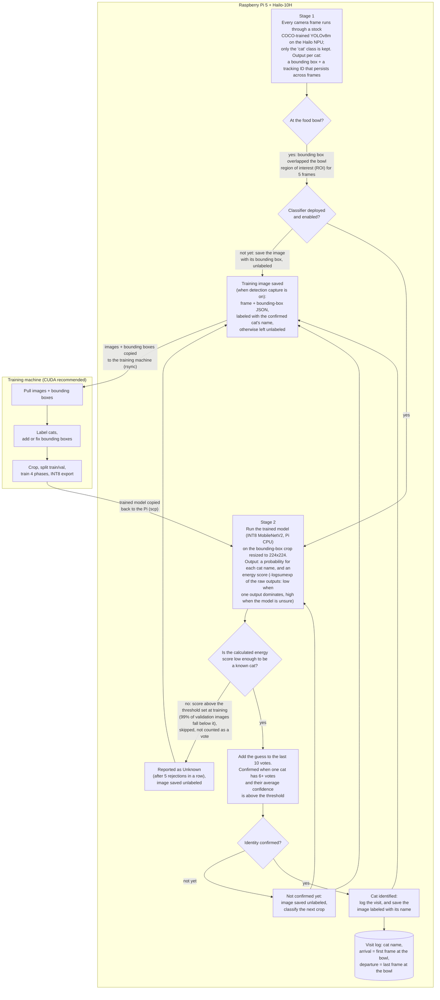

# Purrceptron

Purrceptron identifies individual cats at a food bowl using a Raspberry Pi 5 and a
Hailo-10H accelerator. The stock COCO detector on the NPU finds the cat, an INT8
MobileNetV2 on the CPU identifies which cat it is, and each visit is logged with its
start time, end time and duration. An IR camera keeps it working at night.

The project has two parts that run on different machines:

- `pi_dashboard.py` runs on the Pi. It collects training images from the camera,
  provides a labeling interface, runs detection and identification continuously, and
  displays the visit log. It launches `deploy/detect.py` and the classifier worker.
- `training_dashboard.py` runs on a Linux or WSL2 PC, ideally with a CUDA-capable GPU. It pulls
  images from the Pi, provides labeling and annotation tools, trains the classifier,
  and copies the finished model back to the Pi.

The two sides communicate over SSH: `rsync` to push code and pull images, `scp` to
send the model.

Design points:

- No detector is trained. hailo-apps ships with a COCO-trained YOLOv8m that detects
  cats reliably, and its bounding box is saved alongside every capture. The only
  trained model is the classifier that distinguishes your cats.
- Once a classifier is deployed, detection-triggered capture saves new images under
  the cat name the classifier confirmed, so each training round has more labeled
  data than the previous one with little manual effort.
- The classifier computes an energy score for every crop and rejects crops that do
  not resemble any cat it was trained on. A visiting cat is reported as "Unknown"
  rather than assigned the nearest known name.
- The classifier is trained with quantization-aware training and exported as INT8
  TorchScript, which runs comfortably on one Pi CPU core.

The same approach applies to other animals in the COCO classes (dogs, birds, horses).
Animals outside those classes, such as rabbits, would need a different detector, and
the training dashboard's auto-detect currently looks for cats only.

> **License notice:** source-available for noncommercial use only. No redistribution,
> no commercial use, and no use as AI/ML training data. Models you train with this
> software are for your own noncommercial use only. See [License](#license).

## Contents

- [How it works](#how-it-works)
- [Hardware](#hardware)
- [Software requirements](#software-requirements)
- [Quick start](#quick-start)
- [Pi dashboard](#pi-dashboard)
- [Training dashboard](#training-dashboard)
- [How training works](#how-training-works)
- [Inference details](#inference-details)
- [Configuration reference](#configuration-reference)
- [Project structure](#project-structure)
- [Troubleshooting](#troubleshooting)
- [Known limitations](#known-limitations)
- [Contributing](#contributing)
- [License](#license)

## How it works

The system is a loop between the two machines. The Pi captures training images
while it runs; the training machine turns them into a classifier; the classifier
goes back to the Pi, where it identifies cats and files new captures under their
names, so the next round of training needs less manual labeling.



1. hailo-apps runs a GStreamer pipeline with YOLOv8m on the Hailo-10H, plus a
   tracker that gives each detection a persistent ID. Detections whose label is not
   in `deployment.tracking_objects` (default `["cat"]`) are discarded.
2. A detection is passed to the classifier only after it has overlapped the
   configured bowl region for `classifier.stability_frames` consecutive frames.
3. The crop is resized to 224x224 and classified by MobileNetV2 in a separate
   process on one CPU core, at most once per `classify_interval_seconds`.
4. The classifier can only choose among the cats it was trained on, so it always
   names one of them, even for a cat it has never seen. The softmax confidence does
   not help here: softmax rescales the outputs to sum to 1, so an unfamiliar cat
   whose raw scores are all weak can still come out as "90% Cat1". To catch that,
   each prediction is checked a second time with an energy score computed from the
   same raw outputs (logits), before softmax throws their magnitude away. The energy
   is `-log(sum(exp(logits)))`: one strong logit, which is what your own cats
   produce, gives a low energy; uniformly weak logits, typical of an unfamiliar
   cat, give a high one (Liu et al., 2020, "Energy-based Out-of-distribution
   Detection"). It costs nothing at runtime because it reads the forward pass the
   classifier already ran. The threshold comes from training: the exported INT8
   model scores every validation image, and the cutoff is set so that 99% of them
   pass (`energy_ood_percentile`). It is stored in the model file. A crop whose
   energy is above the threshold is rejected and does not vote, so an unfamiliar cat
   is reported as Unknown instead of being given the nearest known name.
5. A rolling window of predictions confirms an identity once one cat holds a
   majority and the average confidence is above `confidence_threshold`.
6. Each confirmed visit is written to `classifier_log.db` with the cat, the time of
   the first and last frame it was seen at the bowl, the duration, average
   confidence and frame count. The Pi dashboard lists these by day with total
   tracked time per cat.
7. If detection capture is enabled, stable in-bowl detections are saved with their
   bounding box in a JSON sidecar, under the confirmed cat's name or in
   `unlabeled/`, ready for the next training round.

## Hardware

**Raspberry Pi side (capture and inference)**

- Raspberry Pi 5
- [Raspberry Pi AI HAT+ 2](https://www.raspberrypi.com/documentation/accessories/ai-hat-plus.html)
  with the Hailo-10H accelerator (40 TOPS INT4)
- USB camera. Built and tested with the
  [Arducam B0205 1080P Day & Night Vision USB Camera](https://www.amazon.com/dp/B0829HZ3Q7)
  (2MP, IR LEDs, automatic IR-cut switching), which lets detection run in the dark.
  Other USB cameras should work.

**Training side**

- A Linux or WSL2 machine. An NVIDIA GPU with CUDA is recommended but not
  required: without one, training and auto-detect run on the CPU, much more
  slowly. Quantization-aware training and the INT8 export run on the CPU either
  way.

## Software requirements

**Pi**

- 64-bit Raspberry Pi OS with the AI HAT+ 2 drivers installed
  (`sudo apt install hailo-h10-all`) as described in the Raspberry Pi documentation.
  `scripts/setup_pi.sh` does not install the Hailo runtime; it expects it to be there.
- [hailo-apps](https://github.com/hailo-ai/hailo-apps). `setup_pi.sh` clones it into
  `hailo-apps/` inside the project and runs its installer. This project was developed
  against the early-2026 releases.
- Everything runs in the single Python virtual environment that hailo-apps creates
  (`hailo-apps/venv_hailo_apps`), activated with `source hailo-apps/setup_env.sh`.
  `setup_pi.sh` installs `requirements-pi.txt` (Flask, OpenCV, NumPy, PyTorch, PyYAML)
  into it.

**Training machine**

- Python 3.10 or newer (developed on 3.12), `rsync`, `ssh` and `scp`.
- `scripts/setup_training.sh` creates `venv_train` and installs
  `requirements-training.txt` (PyTorch, torchvision, Albumentations, scikit-learn,
  OpenCV, Flask, PyYAML). The training dashboard runs every step with
  `venv_train/bin/python`, so that environment must exist.

## Quick start

```bash
# ── On the training machine ─────────────────────────────────────────────
git clone https://github.com/zstrathe/Purrceptron.git
cd Purrceptron
bash scripts/setup_training.sh          # creates venv_train, reports your GPU

cp configs/project.yaml.example configs/project.yaml
# Edit configs/project.yaml: list your cats under "cats:", set camera.device.

ssh-keygen -t ed25519                   # skip if you already have a key
ssh-copy-id <user>@<pi-hostname>

cat > .env << 'EOF'
PI_USER=<user>
PI_HOST=<pi-hostname>
PI_REMOTE_DIR=~/Repos/cat_detection
EOF

./scripts/sync_to_pi.sh                 # rsync the project (including project.yaml) to the Pi

# ── On the Pi ───────────────────────────────────────────────────────────
ssh <user>@<pi-hostname>
cd ~/Repos/cat_detection
bash scripts/setup_pi.sh                # one time: hailo-apps, Python deps, data dirs
source hailo-apps/setup_env.sh
python pi_dashboard.py                  # open http://<pi-ip>:5003

# In the browser: turn on "Auto-save" under Detection Capture, or use the
# Auto button to capture a chosen cat every few seconds. Aim for 300+ images
# per cat. Label anything in "unlabeled" on the Review tab or later in the
# training dashboard.

# ── Back on the training machine ────────────────────────────────────────
source venv_train/bin/activate
python training_dashboard.py            # open http://localhost:5004
# Run the steps in order: Pull > Label > Crop > Prepare > Train > Deploy.
# Deploy copies the model to the Pi over scp.

# ── On the Pi ───────────────────────────────────────────────────────────
# Turn on "Enable classifier" in the dashboard. The pipeline restarts with
# the new model and the identity bar shows who is at the bowl.
```

`sync_to_pi.sh` pushes `configs/project.yaml` too, so edit it on the training machine.
Settings changed in the Pi dashboard are stored separately in `configs/runtime.yaml`
on the Pi, which is never synced, so they survive the next push.

## Pi dashboard

`pi_dashboard.py` runs on the Pi and serves on port 5003. It starts `deploy/detect.py`
as a subprocess from inside `hailo-apps/` with `setup_env.sh` sourced, restarts it if
it crashes, and restarts it when a new classifier model is copied over (provided the
classifier was enabled when the dashboard started).

```bash
python pi_dashboard.py --no-camera        # review only, no detection pipeline
python pi_dashboard.py --host 0.0.0.0 --port 8080
python pi_dashboard.py --config alt.yaml
```

### Capture tab

The live feed is a JPEG preview that the browser polls about 15 times a second.
Bounding boxes are drawn with the detector label, confidence and tracker ID. Around it:

- Detection Mode: pipeline status, the tail of the detector log, and a viewer for
  the log files in `logs/detection/`.
- Detection Capture: an auto-save toggle, the minimum seconds between saves per
  cat, and "Save labeled only", which skips captures the classifier has not
  identified. Changes take effect immediately.
- Cat Classifier (Stage 2): an enable toggle (restarts the pipeline with the
  model), model status, confidence threshold, and the bowl region. Drag on the
  preview to set the region, show or hide it, and set the overlap percentage that
  counts as being at the bowl. Changes take effect immediately and are saved to
  `runtime.yaml`.
- The identity bar shows the current result with vote counts (for example
  `Cat1:6 Cat2:2 / 10`), "Unknown" for rejected crops, and "Waiting for detection in
  ROI..." between visits.
- Auto capture: a toggle and a target-cat dropdown. While on, a full frame is saved
  under that cat every `collection.auto_capture_interval_sec` seconds (default 3),
  with a bounding-box sidecar whenever the detector saw a cat in the frame.

### Review tab

A split view: the current image and its controls on the left, and a resizable,
full-height image browser on the right. There is one label button per cat, plus
Delete (moves the file to `data/trash/`), Prev and Skip. Skip marks the image as
reviewed. Unreviewed images are queued newest first; the browser shows every image,
with reviewed ones dimmed.

In the browser, click opens an image, Ctrl/Cmd-click or right-click selects, and
Shift-click selects a range. Selected images can be labeled or deleted together.
The browser sorts by newest or by label and filters with chips for All, Unlabeled
and each cat. Thumbnails are generated once and cached under `data/raw/.thumbnails/`.

Keyboard shortcuts: `1` to `9` label as that cat, `d` delete, `n` or `→` skip, `p` or
`←` previous, `Esc` closes the log viewer.

### Sidebar

Shown on the Capture tab: image counts per cat against
`collection.min_images_per_cat`, session counters, pipeline status, recent
detections, and, when the classifier is enabled, the day's identified visits from
`classifier_log.db` with total tracked time per cat. Arrow buttons step through
earlier days.

## Training dashboard

`training_dashboard.py` runs on the training machine and serves on port 5004 (`--host`,
`--port` and `--config` are the only options). Work is organized into versions. Each
version is a directory under `versions/` holding that round's images, crops, dataset,
training output and model. Versions can be created, renamed, duplicated and deleted
from the Pipeline tab.

### Pipeline tab

The six steps can be run individually or with Run All, which skips the interactive
Label step. Each step's output is streamed to the page and saved under
`logs/training/`.

| Step | What it does |
|------|--------------|
| **Pull** | `rsync` the Pi's `data/raw/` to the local `data/raw/` (using `.env`; the local copy mirrors the Pi, deletions included), then copy images and sidecars into `versions/<v>/raw_images/`. |
| **Label** | Opens the Label tab: every `unlabeled/` image, oldest first, with the Pi's detector bounding box overlaid. Assign each to a cat and the image and its sidecar move to that cat's folder. Skip moves it to `unlabeled/skipped/`; Undo reverses the last 20 actions. Keys `1` to `9` assign, `s` skips. |
| **Crop** | `train/crop_images.py`: cut each cat out using the highest-confidence bounding box in its sidecar, padded by `classifier.crop_padding`, and resize to 224x224. Images without a sidecar are skipped and reported. |
| **Prepare** | `train/prepare_classifier_dataset.py`: split crops into `train/` and `val/`. Images are grouped into sessions by timestamp (`session_gap_minutes`) and 20% of each cat's sessions go to validation, so consecutive frames from one session cannot end up on both sides of the split. |
| **Train** | `train/train_classifier.py`: the four-phase training described below. |
| **Deploy** | `scripts/transfer_model.sh`: `scp` the model to `models/cat_classifier.pt` on the Pi, with retries. The Pi dashboard restarts the pipeline with the new model if the classifier is enabled. |

A separate Cross-validate button runs `train/cross_validate.py` on the crops:
session-aware stratified k-fold (`cv_folds`, default 5) with a simplified recipe (no
SWA, warmup or export). It gives an estimate of generalization before a full
training run.

Collapsible panels on the same tab edit the training hyperparameters, the crop
padding ("Save & Re-crop") and the augmentation switches. They are written back to
`configs/project.yaml`. Keyboard: `1` to `7` run the steps in order (7 is
Cross-validate), `r` runs all, `s` stops.

### Annotate tab

Lists every image in the version, grouped by folder, with each saved bounding box drawn on
its thumbnail and a "Missing" badge on those without one. A status filter (All,
Missing, Annotated) and per-cat chips narrow the list; it opens on Missing. This is
where images that arrived without a bounding box (phone photos, older captures) get one:
draw a bounding box by dragging, or click Auto-detect to get one from a COCO-pretrained
torchvision Faster R-CNN (ResNet50 FPN v2), using the GPU when one is available.
"Auto-detect all missing" processes every image without a bounding box. Bounding boxes are saved as
soon as they are drawn, in the same sidecar format the Pi writes, so the Crop step
treats them the same way. Editing a Pi-generated bounding box keeps a backup, and Clear
restores it. Keyboard shortcuts: `a` auto-detect, `d` clear, `n`/`p` or the arrow
keys step through the filtered list.

### Metrics tab

Loss, accuracy and per-class validation accuracy charts for each training phase, the
best epoch, dataset counts, and a "Compare with" dropdown that overlays another
version's curves and shows the difference in best validation accuracy.

### Manual CLI

The same scripts can be run directly. Paths have to be given explicitly because the
scripts do not know about versions:

```bash
source venv_train/bin/activate
V=versions/v1
bash scripts/pull_dataset.sh
python train/import_captures.py --output-dir $V/raw_images
python train/crop_images.py --input-dir $V/raw_images --output-dir $V/cropped_images --padding 0.2
python train/prepare_classifier_dataset.py --source-dir $V/cropped_images --output-dir $V/classifier_dataset
python train/cross_validate.py --source-dir $V/cropped_images --output-dir $V/cv_results   # optional
python train/train_classifier.py --dataset-dir $V/classifier_dataset --output-dir $V
bash scripts/transfer_model.sh $V/cat_classifier.pt
```

`train_classifier.py --skip-phase N` skips a phase (1 to 3). Skipping phase 3 also
skips the INT8 export.

## How training works

The classifier is torchvision's quantizable MobileNetV2 with ImageNet weights. The
backbone is kept and a new linear head, sized to the number of cats, is trained on
top. Training requires at least two cats and runs in four phases.

1. Head warmup (FP32, default 20 epochs). Only the new head trains; the backbone is
   frozen. Learning rate 1e-3 with a linear warmup over `warmup_epochs` (default 5)
   followed by cosine decay.
2. Partial fine-tune (FP32, default 40 epochs). The last three feature stages of the
   backbone (`features[16:]`, two inverted-residual blocks and the final 1x1
   convolution) are unfrozen at 1e-5 while the head continues at 1e-4. Batch-norm
   statistics stay frozen. Mixup (`mixup_alpha`, default 0.2) is applied in this
   phase only. Stochastic weight averaging runs over the final 25% of the phase, and
   the averaged model replaces the checkpoint if its validation accuracy is at least
   as good. If accuracy is low, this is the phase to lengthen.
3. Quantization-aware training (default 10 epochs, CPU). The model is fused and
   trained with simulated INT8 quantization (qnnpack backend) at a fixed 1e-6
   learning rate and without augmentation, so it adapts to 8-bit rounding.
   Observers are frozen for the last 20% of the phase.
4. INT8 export. The model is converted, traced and frozen into a TorchScript file.

All phases use AdamW with `weight_decay` 0.005, batch size 32, label smoothing 0.1,
gradient clipping at norm 1.0, and early stopping after `patience` (default 15)
epochs without an improvement in validation accuracy. Class imbalance is handled
with class-weighted cross-entropy (`balance_classes`) rather than oversampling. The
best checkpoint of each phase is selected by validation accuracy.

Augmentation uses Albumentations: a random resized crop (scale 0.8 to 1.0) is always
applied, and horizontal flip, brightness/contrast, shift-scale-rotate, Gaussian blur,
coarse dropout and Gaussian noise are on by default. Hue/saturation and CLAHE are
available and enabled in the shipped template. Validation applies normalization only.

After export, the INT8 model scores every validation image and the
`energy_ood_percentile` quantile (default 0.99) of those energy values becomes the
rejection threshold. It is embedded in the model file with the class list, so the Pi
needs no extra configuration for unknown-cat rejection.

Outputs are `models/cat_classifier.pt` (overwritten by every run), a copy at
`versions/<v>/cat_classifier.pt`, `versions/<v>/training/results.csv` with per-epoch
loss, accuracy and per-class validation accuracy, and the best checkpoint of each
phase. The script ends by evaluating the exported INT8 model on the validation set
and printing overall and per-class accuracy.

## Inference details

`deploy/detect.py` wraps hailo-apps' `GStreamerDetectionApp`. The dashboard starts it
with `cd hailo-apps && source setup_env.sh && python deploy/detect.py --enable-preview
--enable-stdin-commands`. To run it manually, use the same two environment steps.
Any extra arguments (for example `--input /dev/video2`) are passed through to
hailo-apps. Settings come from `configs/project.yaml` with `configs/runtime.yaml`
merged on top.

Gate: overlap is the intersection area divided by the bowl region's area, compared
with `classifier.roi_overlap_threshold` (default 1%). A detection that leaves the
region keeps its stability count for `classifier.miss_tolerance` frames (default 15);
after that the count resets and a departure signal closes the current visit.

Classifier worker: started before GStreamer initializes and pinned to
`classifier.cpu_core`. It loads the TorchScript model with the qnnpack engine, reads
the class list and energy threshold from the model file (a
`classifier.energy_ood_threshold` setting overrides the embedded value), and applies
ImageNet normalization. Crops arrive on a bounded queue and are dropped when the
CPU falls behind. Each crop gets one forward pass; the energy score and the softmax
probabilities are both read from its logits, and the energy check runs first so a
rejected crop never reaches the vote window. The worker's state is written to `/tmp/cat_classifier_status.json`,
which the dashboard polls twice a second.

Vote window: a prediction is confirmed when one class holds more than half of
`vote_window_size` votes (6 of 10 by default) and the average confidence of those
votes is at least `confidence_threshold`. Rejected crops do not vote. "Unknown" is
reported after half a window of consecutive rejections.

Event log: `classifier_log.db`, table `classifier_events`, with `cat_name`,
`start_time`, `end_time` (UTC), `duration_seconds`, `confidence_avg` and
`frame_count`. The detector timestamps the first and last frame of each visit at
the bowl, so `start_time` is when the cat arrived, not when the vote confirmed it
(at least several seconds later). The row is written once the identity is
confirmed and closed when the cat leaves; on shutdown the end time is the shutdown
time.

Detection-triggered capture: when enabled, a detection is saved once it is stable
inside the bowl region, at most once per `min_interval_seconds` per label. Labels
listed in `unlabeled_classes` (`cat` for the stock model) are saved under the
classifier's confirmed name when there is one, otherwise under `unlabeled/`. Each
image gets a `.json` sidecar with the timestamp, image size and the in-region
detections (`label`, `confidence`, and `bbox_norm` as `[xmin, ymin, w, h]` in the
range 0 to 1), plus a line in `data/raw/capture_log.csv`. Files are named
`<label>_<UTC timestamp>.jpg`.

Feeding tracker (`feeding.*`): an earlier session tracker driven only by detector
labels. It logs a session only when the detector itself outputs one of your cats'
names, which requires a custom HEF trained on them. With the stock COCO model,
per-cat visit logging comes from the classifier event log described above, which is
what the dashboard displays.

## Configuration reference

All settings live in `configs/project.yaml` (gitignored; copy
`configs/project.yaml.example`). The Pi dashboard writes the settings it changes to
`configs/runtime.yaml`, which overrides `project.yaml` on the Pi and is not synced.
The table lists the template's value; where the code uses a different fallback when
a key is omitted, it is noted.

| Key | Template value | Description |
|-----|----------------|-------------|
| `cats` | `[Cat1, Cat2, Cat3]` | Your cats' names. Required. Used as folder names, labels and dashboard buttons. Training needs at least two. |
| **Camera** | | |
| `camera.device` | `/dev/video0` | Passed to hailo-apps as `--input`. |
| `camera.width` / `height` | 1920 / 1080 | The camera's frame size. Used to convert normalized bounding boxes to pixels for the bowl-region test, so it must match the real frame size. |
| **Collection** | | |
| `collection.output_dir` | `data/raw` | Root of captured images on the Pi, used for review and counts. Required. |
| `collection.min_images_per_cat` | 300 | Per-cat target shown by the dashboard's progress bars. |
| `collection.auto_capture_interval_sec` | 3 | Seconds between frames in auto-capture mode. |
| **Web UI** | | |
| `web_ui.host` / `port` | `0.0.0.0` / 5003 | Pi dashboard bind address and port. Required. |
| `web_ui.preview_width` / `height` | 960 / 540 | Preview frame size. |
| **Deployment** | | |
| `deployment.hailo_apps_dir` | `./hailo-apps` | hailo-apps checkout, relative to the project root. |
| `deployment.hef_path` | `""` | Custom HEF model. Empty uses hailo-apps' default detector for the board. |
| `deployment.labels_json` | `""` | Label file for a custom HEF (hailo-apps format; see `deploy/coco_labels.json`). |
| `deployment.track_all` | true | Track every class, not only class 0. |
| `deployment.tracking_objects` | not in template; code default `[cat]` | Detector labels to keep. Everything else is dropped before the gate. |
| `deployment.preview_path` | `/tmp/cat_detection_preview.jpg` | Preview frame location. The dashboard reads this exact path, so leave it. |
| `deployment.preview_fps` | 15 (code fallback 10) | Preview write rate. |
| `deployment.preview_jpeg_quality` | not in template; code default 70 | Preview JPEG quality. |
| **Classifier (Stage 2)** | | |
| `classifier.enabled` | false | Run the identity classifier. |
| `classifier.model_path` | `models/cat_classifier.pt` | TorchScript model. |
| `classifier.bowl_roi` | `[760, 390, 1160, 790]` (code fallback: full frame) | Bowl region `[x_min, y_min, x_max, y_max]` in frame pixels. Set it by dragging in the dashboard. |
| `classifier.roi_overlap_threshold` | 0.01 | Fraction of the bowl region a bounding box must cover to count. |
| `classifier.stability_frames` | 5 | Consecutive in-region frames before classifying (also gates detection capture). |
| `classifier.miss_tolerance` | not in template; code default 15 | Missed frames tolerated before a cat counts as departed. |
| `classifier.classify_interval_seconds` | 1.0 | Minimum time between crops sent to the classifier. |
| `classifier.crop_padding` | 0.0 (code fallback 0.2) | Padding around the bounding box as a fraction of its size, for live crops and the Crop step. |
| `classifier.vote_window_size` | 10 | Votes in the rolling window. |
| `classifier.confidence_threshold` | 0.5 (code fallback 0.85) | Minimum average confidence to confirm. |
| `classifier.energy_ood_enabled` | not in template; code default true | Reject crops above the energy threshold. |
| `classifier.energy_ood_threshold` | not in template; default from the model | Override the embedded threshold. |
| `classifier.db_path` | `data/classifier_log.db` | Identified-visit log. |
| `classifier.cpu_core` | 3 | Core the classifier process is pinned to. |
| **Detection capture** | | |
| `detection_capture.enabled` | false | Save stable in-region detections automatically. |
| `detection_capture.output_dir` | `data/raw` | Where captures go (also used for manual captures). |
| `detection_capture.unlabeled_classes` | `[cat]` (code fallback `[]`) | Detector labels saved as `unlabeled/`, or under the classifier's confirmed name. |
| `detection_capture.save_labeled_only` | false | Skip captures that would land in `unlabeled/`. |
| `detection_capture.min_interval_seconds` | 15 | Minimum seconds between saves per label. |
| `detection_capture.max_captures_per_session` | 0 | Cap per label per run; 0 is unlimited. |
| `detection_capture.jpeg_quality` | 95 | JPEG quality. |
| `detection_capture.csv_logging` | true | Append to `capture_log.csv`. |
| **Feeding tracker** (see the note above) | | |
| `feeding.enabled` | false | Detector-label session tracking. |
| `feeding.db_path` | `data/feeding_log.db` | Session database. |
| `feeding.cooldown_seconds` | 30 | Seconds without detection before a session ends. |
| `feeding.min_detection_frames` | 3 | Frames before a session starts. |
| `feeding.log_interval_seconds` | 60 | Console status interval. |
| **Review** | | |
| `label_review.trash_dir` | `data/trash` | Where deleted captures are moved. |
| **Classifier training** | | |
| `classifier_training.phase1_epochs` | 20 | Head warmup epochs. |
| `classifier_training.phase2_epochs` | 40 | Fine-tune epochs. |
| `classifier_training.phase3_epochs` | 20 (code fallback 10) | QAT epochs. |
| `classifier_training.phase1_lr` | 0.001 | Phase 1 learning rate. |
| `classifier_training.phase2_backbone_lr` | 1e-5 | Phase 2 backbone learning rate. |
| `classifier_training.phase2_head_lr` | 1e-4 | Phase 2 head learning rate. |
| `classifier_training.warmup_epochs` | 5 | Linear warmup epochs in phase 1. |
| `classifier_training.weight_decay` | 0.005 | AdamW weight decay. |
| `classifier_training.batch_size` | 32 | Batch size. |
| `classifier_training.label_smoothing` | 0.1 | Cross-entropy label smoothing. |
| `classifier_training.gradient_clip_norm` | 1.0 | Gradient-norm clipping. |
| `classifier_training.mixup_alpha` | 0.2 | Mixup strength (phase 2). |
| `classifier_training.balance_classes` | true | Class-weighted loss for imbalanced data. |
| `classifier_training.patience` | 15 | Early-stopping patience, per phase. |
| `classifier_training.session_gap_minutes` | 5 | Gap that starts a new session for the train/val split and CV folds. |
| `classifier_training.cv_folds` | 5 | Folds for the dashboard's Cross-validate button. |
| `classifier_training.energy_ood_percentile` | not in template; code default 0.99 | Validation-energy quantile used as the unknown-cat threshold. |
| `classifier_training.augmentation.*` | see template | Switches and limits for each augmentation: `horizontal_flip`, `brightness_contrast`, `brightness_limit`, `contrast_limit`, `shift_scale_rotate`, `rotate_limit`, `gaussian_blur`, `gaussian_noise`, `coarse_dropout`, `hue_saturation`, `clahe`. |

Keys in the template that nothing reads: `camera.fps`, `camera.format`,
`collection.images_per_session`, `collection.capture_interval_ms`,
`collection.jpeg_quality`, `deployment.detection_threshold`, `deployment.hw_arch`,
`deployment.filter_classes`, `detection_capture.filter_labels`, `label_review.host`,
`label_review.port` and `classifier_training.optimizer` (AdamW is always used).

## Project structure

```
Purrceptron/
├── pi_dashboard.py                 # Pi web dashboard: capture, review, pipeline control (port 5003)
├── training_dashboard.py           # Training dashboard: versions, pipeline steps, annotate, metrics (port 5004)
├── templates/
│   ├── dashboard.html              # Pi dashboard UI
│   └── training_dashboard.html     # Training dashboard UI
├── static/css/theme.css            # Shared dashboard theme (colors, layout, image browser)
├── configs/
│   └── project.yaml.example        # Configuration template (copy to project.yaml)
├── deploy/                         # Runs on the Pi
│   ├── detect.py                   # hailo-apps GStreamer pipeline, gate, capture, stdin commands
│   ├── cat_classifier.py           # Classifier worker process: INT8 MobileNetV2, energy check, voting, event log
│   ├── detection_capturer.py       # Frame extraction and asynchronous capture with sidecars
│   ├── feeding_tracker.py          # Detector-label session tracker
│   └── coco_labels.json            # COCO label list in hailo-apps format, for custom HEFs
├── collect/                        # Pi dashboard helpers
│   ├── label_review.py             # Review queue, thumbnails, relabel and delete
│   ├── export.py                   # Standalone dataset archive export (CLI)
│   └── capture.py                  # Legacy standalone capture app, not used by the dashboard
├── train/                          # Runs on the training machine
│   ├── import_captures.py          # Copy data/raw/ into a version
│   ├── crop_images.py              # Crop detections using bbox sidecars
│   ├── prepare_classifier_dataset.py  # Session-aware train/val split
│   ├── train_classifier.py         # Four-phase MobileNetV2 training and INT8 export
│   └── cross_validate.py           # Session-aware stratified k-fold
├── scripts/
│   ├── setup_pi.sh                 # Pi setup: hailo-apps, Python deps, data dirs
│   ├── setup_training.sh           # Training venv and GPU check
│   ├── sync_to_pi.sh               # rsync the project to the Pi (.syncignore applies)
│   ├── pull_dataset.sh             # rsync data/raw/ from the Pi
│   ├── transfer_model.sh           # scp a model to the Pi
│   └── _common.sh                  # Shared helpers (.env loading)
├── utils/
│   ├── config.py                   # Config loading, runtime.yaml merge, path resolution, cat colors
│   ├── display.py                  # Colored console output
│   └── thumbnails.py               # Cached thumbnails for the dashboards' image browsers
├── requirements-pi.txt
├── requirements-training.txt
└── requirements-scripts.txt
```

Runtime directories (gitignored): `data/` (captures, trash, logs on the Pi),
`versions/` (training rounds), `models/` (deployed model), `logs/`, `hailo-apps/`,
`venv_train/`.

## Troubleshooting

"Hailo libraries not available": the detector has to run from the hailo-apps
environment (`cd hailo-apps && source setup_env.sh`). The dashboard does this
itself, so the error usually means `setup_pi.sh` has not been run or
`deployment.hailo_apps_dir` points to the wrong place.

Camera not found: run `ls /dev/video*` and set `camera.device` in
`configs/project.yaml`, or pass `--input /dev/videoN` to `detect.py`. `lsusb` should
list the camera.

Preview is slow: the preview rate is limited by `deployment.preview_fps` and by the
load on the Pi. It is independent of the detector's frame rate. Reducing
`web_ui.preview_width` and `height` helps.

Classifier shows "No model found" or never activates: the model must be at
`models/cat_classifier.pt` on the Pi (the Deploy step copies it there), and
"Enable classifier" must be on, which restarts the pipeline. The classifier only
runs for detections inside the bowl region, so check the region with "Show ROI" and
lower `roi_overlap_threshold` if detections rarely qualify.

Identity flips, or takes too long to confirm: raise `vote_window_size` for steadier
results, or lower `confidence_threshold` to confirm sooner. Confirmation needs a
majority of the whole window, so 10 votes at one crop per second takes at least
6 seconds.

Everything shows as Unknown: the energy threshold was calibrated on your validation
images, and lighting very different from the training data raises energy scores.
Add images from those conditions and retrain, raise
`classifier.energy_ood_threshold`, or set `energy_ood_enabled: false`.

Wrong cat identified: check per-class accuracy on the Metrics tab and run
Cross-validate. Collect more images of the weak cat in varied lighting and retrain,
lengthening phase 2 first.

Crop step skips images: those images have no bounding-box sidecar. Add bounding boxes on
the Annotate tab, or pull again after enabling detection capture on the Pi.

Dashboard not reachable: both dashboards bind to all interfaces. Check the Pi's
firewall for port 5003, and use the IP address if `.local` names do not resolve.

## Known limitations

- Neither dashboard has authentication. Run them on a trusted network only.
- Relabeling or deleting a capture on the Pi's Review tab moves only the JPEG. The
  bounding-box sidecar stays behind, so Crop skips that image. The training
  dashboard's Label tab moves both files.
- Images still in `data/raw/unlabeled/` on the Pi are imported into
  `raw_images/unlabeled/` again on every Pull, even if they were labeled in a
  previous version.
- The feeding tracker only works with a custom HEF that outputs your cats' names.
- Prepare produces train and validation splits only. There is no held-out test set.
- Every training run overwrites `models/cat_classifier.pt` as well as the version's
  copy.
- The cross-validation results panel on the Metrics tab does not render yet. Read
  `versions/<v>/cv_results/cv_summary.json` or the step log instead.
- The classifier has only been tested on cats that are easy to tell apart. With two
  look-alike cats the vote window would stall rather than misidentify, so visits
  would go unlogged. What would help, and in what order, is written up in
  [docs/future_work.md](docs/future_work.md).

## Contributing

Contributions are welcome. See [CONTRIBUTING.md](CONTRIBUTING.md) for how to submit a pull request and the terms that apply to contributions.

## License

This project is source-available under the [Purrceptron Source-Available License 1.0](LICENSE.md):

- **Allowed:** using the software for noncommercial purposes, and changing it privately for your own setup.
- **Allowed:** forking the repository solely to contribute changes back through pull requests (see [CONTRIBUTING.md](CONTRIBUTING.md)).
- **Not allowed:** redistributing the software, publishing modified versions, or maintaining a fork as a separate project.
- **Not allowed:** using the software, or any part of it, as training, evaluation, or retrieval data for any AI or machine learning model, giving it to an AI service whose provider is allowed to train on it, or text and data mining. All such rights are reserved. AI coding assistants are fine if their terms don't let the provider train on your input.
- **Not allowed:** commercial use without a separate license from the author.
- **Trained models:** any model you train with the software may be used only by you, for noncommercial purposes. You may not share, sell, or commercially use it.

Third-party components are listed in [THIRD_PARTY_NOTICES.md](THIRD_PARTY_NOTICES.md).
